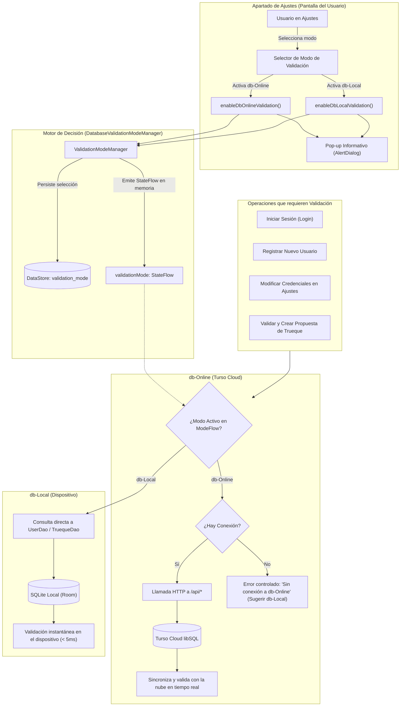
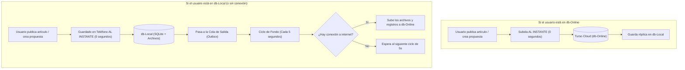
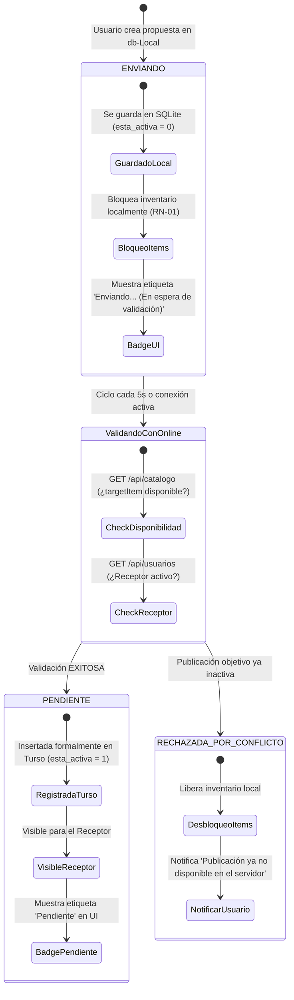
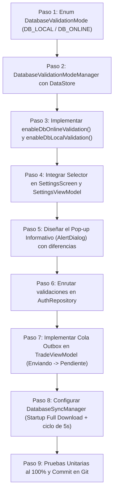

# Arquitectura y Guía de Modos de Validación de Base de Datos: `db-Local` vs `db-Online`

Este documento describe la especificación técnica, el funcionamiento operativo, los casos de uso con y sin conexión a internet, las frecuencias de actualización (reducidas a **cada 5 segundos**), la descarga completa al abrir la app, la mecánica y cadencia de subida de archivos (al instante vs. en cada ciclo), el ciclo de vida de propuestas de trueque con cola de validación (**"Enviando"** → **"Pendiente"**) y la serie de pasos para integrar la conmutación entre **`db-Local`** y **`db-Online`** en **Truequapp**.

---

## 1. Nomenclatura Oficial

A partir de esta implementación, la aplicación adopta oficialmente los siguientes dos nombres para sus motores de base de datos y validación:

| Nombre Oficial | Tipo de Base de Datos | Ubicación | Descripción |
| :--- | :--- | :--- | :--- |
| **`db-Local`** | SQLite / Room + Preferences DataStore | En el almacenamiento interno del dispositivo | Gestiona y valida la información localmente en el teléfono. Máxima velocidad e inmediatez. Permite operar 100% sin internet. |
| **`db-Online`** | libSQL (Turso Cloud) vía API REST Vercel | En la nube (servidores distribuidos de Turso) | Gestiona y valida la información contra la base de datos central en la nube. Coherencia multi-dispositivo y sincronía global en tiempo real. |

---

## 2. Diagrama General de Arquitectura y Conmutación



---

## 3. Comportamiento Detallado: `db-Local`

Cuando el usuario activa el modo **`db-Local`**, las validaciones de usuario, contraseñas y datos del perfil se resuelven contra la base de datos interna SQLite/Room alojada en el teléfono.


### 3.1. ¿Cómo funciona `db-Local` CON conexión a internet?
- **Validación instantánea:** Al iniciar sesión, registrarse o modificar datos de la cuenta, la comprobación de credenciales, balance de monedas y existencia se realiza directamente contra la base de datos interna SQLite (`db-Local`). La respuesta toma milisegundos (< 5 ms) y no sufre por lentitud o latencia de red.
- **Sincronización en segundo plano no bloqueante:** Como hay conexión a internet, el motor de sincronización (`DatabaseSyncManager`) continúa ejecutándose en segundo plano **cada 5 segundos** para descargar publicaciones nuevas o cambios del catálogo general de Turso hacia la caché local, pero **ninguna validación se bloquea** esperando respuesta del servidor.
- **Ventaja clave:** Fluidez absoluta de la interfaz sin consumir datos móviles para cada validación.

### 3.2. ¿Cómo funciona `db-Local` SIN conexión a internet (Modo 100% Offline)?
- **Operatividad total garantizada:** La aplicación sigue funcionando con normalidad. Todas las consultas (`UserDao`, `TruequeDao`, `UserPublicationStorage`) se ejecutan contra los archivos locales del teléfono.
- **Cero errores de red en pantalla:** No se producen excepciones de tipo `UnknownHostException` ni pantallas de espera infinitas para validar contraseñas o datos del perfil.
- **Manejo del ciclo de sincronización:** `DatabaseSyncManager` detecta de forma limpia la falta de conexión y, en lugar de alertar al usuario con diálogos molestos, mantiene el estado en reposo (`SyncState.ConnectionError`) de forma silenciosa o con un banner discreto en la parte inferior, permitiendo al usuario continuar su navegación sin interrupciones.
- **Ventaja clave:** La app nunca se queda inaccesible si el usuario está en el metro, en carretera o en zonas sin señal.

---

## 4. Comportamiento Detallado: `db-Online`

Cuando el usuario activa el modo **`db-Online`**, las validaciones se dirigen a los servidores centrales de Turso Cloud a través de la API en Vercel (`/api/*`).

### 4.1. ¿Cómo funciona `db-Online` CON conexión a internet?
- **Validación global en tiempo real:** Cuando el usuario valida un correo, contraseña o propuesta, la consulta va directamente a la nube. Si otro usuario en otro dispositivo acaba de registrar un correo idéntico hace un segundo o modificó un trueque, `db-Online` lo detecta inmediatamente evitando colisiones.
- **Replicación local inmediata:** Una vez que Turso aprueba la validación o modificación (código HTTP 200), los datos actualizados se replican de inmediato en `db-Local` y en el `UserSessionDataStore`, manteniendo ambas bases en sincronía absoluta.
- **Ventaja clave:** Integridad multi-usuario y multi-dispositivo sin inconsistencias.

### 4.2. ¿Cómo funciona `db-Online` SIN conexión a internet?
- **Detección segura del fallo:** Si el dispositivo no tiene acceso a internet o Turso no responde, la aplicación captura la excepción de conexión (`SocketTimeoutException`, `UnknownHostException`).
- **Resiliencia y continuidad operativa:** La app no se congela ni crashea. Muestra un mensaje claro:
  > *"Error de conexión con la base de datos en línea (db-Online). Puedes conmutar a db-Local en el apartado de Ajustes para operar sin internet."*
- **Acceso a Ajustes garantizado:** La pantalla de **Ajustes** permanece siempre accesible para que el usuario pueda cambiar a `db-Local` con un solo toque y continuar trabajando de inmediato.

---

## 5. Ciclo de Validaciones y Frecuencias (Reducido a cada 5 segundos)

Es fundamental distinguir entre los tres tipos de ciclos que operan en la aplicación:

```mermaid
flowchart TD
    subgraph CicloStartup["0. Descarga Completa al Abrir la App"]
        AppStart["Apertura de la App (onCreate / Splash)"] --> FullDownload["Descarga Inmediata de todo db-Online a db-Local"]
        FullDownload --> Ready["App lista con datos 100% frescos desde el primer segundo"]
    end

    subgraph Ciclo1["1. Ciclo Transaccional (Bajo Demanda)"]
        ActionUser["Acción del Usuario (Click en botón)"] --> ValidacionInmediata["Validación Inmediata (0 segundos)"]
        ValidacionInmediata --> RespInmediata["Respuesta en Pantalla (Éxito / Error)"]
    end

    subgraph Ciclo2["2. Ciclo Periódico de Reconciliación (Cada 5 segundos)"]
        Timer["Temporizador de Fondo (delay 5s)"] --> SyncJob["DatabaseSyncManager.syncDatabase()"]
        SyncJob --> FetchNube["Descarga novedades de Turso"]
        FetchNube --> RevalidaCola["Revalida propuestas y sube cola de salida (Outbox)"]
    end
```



### 5.1. Descarga Completa al Abrir la App (Startup Full Download)
- **Momento de ejecución:** En el primer milisegundo en que la aplicación arranca (`MainActivity.onCreate()` o inicialización de la sesión).
- **Qué realiza:**
  - Sin esperar a que transcurra el intervalo de 5 segundos, dispara una sincronización completa inmediata (`syncDatabase()`).
  - Descarga todo el catálogo global de `db-Online`, todas las propuestas de trueque y los balances de usuarios actualizados directamente hacia `db-Local` (Room y almacenamiento en disco).
  - Si el dispositivo no tiene internet al arrancar, el arranque no se bloquea: carga instantáneamente la última versión guardada en `db-Local`.

### 5.2. Ciclo Transaccional (Bajo Demanda / En el momento de la acción)
- **Frecuencia:** **Inmediata (0 segundos de espera)**.
- **Cuándo ocurre:** Cada vez que el usuario realiza una acción interactiva:
  - Al pulsar *"Iniciar Sesión"* → Se valida correo y contraseña en ese instante.
  - Al pulsar *"Registrarse"* → Se valida unicidad del correo en ese instante.
  - Al pulsar *"Guardar Cambios"* en Ajustes → Se valida el nuevo nombre, contraseña y correo en ese instante.
  - Al pulsar *"Enviar Propuesta de Trueque"* → Se ejecuta la validación de inventario y saldo de monedas en ese instante.
- **Tiempo de respuesta:**
  - En `db-Local`: **1 a 5 milisegundos**.
  - En `db-Online`: **150 a 600 milisegundos** (dependiendo de la latencia de red).

### 5.3. Ciclo Periódico de Reconciliación y Sincronización (Cada 5 segundos)
- **Frecuencia:** **Cada 5 segundos exactos** (`5_000L ms`), optimizado desde los 15 segundos anteriores para brindar una sincronización casi en tiempo real.
- **Dónde corre:** En una corrutina de fondo (`CoroutineScope`) gestionada por `DatabaseSyncManager`:
  ```kotlin
  while (isActive) {
      syncDatabase()
      delay(5_000L) // Intervalo exacto de 5 segundos
  }
  ```
- **Qué hace cada 5 segundos:**
  1. Consulta a Turso (`GET /api/catalogo`) para actualizar el feed global de artículos.
  2. Consulta a Turso (`GET /api/trueques`) para actualizar las ofertas recibidas y enviadas.
  3. Consulta a Turso (`GET /api/usuarios/login` o balance) para mantener al día los TruequeCoins y calificaciones.
  4. **Procesa la cola de salida y trueques en espera:** Revalida cualquier propuesta o archivo que se haya creado en modo local (estado *"Enviando"*) contra el servidor central para pasarla a *"Pendiente"*.
- **Comportamiento Silencioso vs. Aviso Manual:**
  - **Actualización automática periódica:** Es **100% silenciosa**. No muestra avisos, toasts ni snackbars en la interfaz para no interrumpir al usuario cada 5 segundos mientras navega o chatea.
  - **Actualización manual por botón:** El aviso (*"Catálogo actualizado desde la nube."*) **únicamente se muestra cuando el usuario presiona el botón de actualizar** ubicado en la barra de búsqueda de la pantalla de Catálogo (`IconButton` de refresco).

---

## 6. ¿Cómo y Cada Cuándo se suben los archivos a `db-Online`? (¿Al instante o en cada ciclo?)

Esta es una de las distinciones más importantes de la arquitectura: la cadencia de subida depende de si la acción se origina en **`db-Online`** o en **`db-Local`**.



### 6.1. Si el usuario está en `db-Online`: Subida AL INSTANTE (0 segundos)
- Al pulsar *"Publicar Artículo"* o guardar cambios:
  - **Inmediatez:** La subida se realiza **al instante**.
  - La imagen se comprime en el dispositivo a WebP (< 300 KB) y se envía inmediatamente vía HTTP `POST` a `/api/catalogo`.
  - La API de Vercel escribe el registro en Turso en menos de medio segundo.
  - Al recibir HTTP 200 de Turso, la app guarda una réplica idéntica en `db-Local` para lectura inmediata sin consumir red en el futuro.

### 6.2. Si el usuario está en `db-Local`: Guardado local AL INSTANTE y subida EN CADA CICLO (cada 5 segundos)
- Cuando el usuario crea una publicación, archivo o propuesta estando en `db-Local` (o sin internet en ese instante):
  - **1. Guardado en el dispositivo: AL INSTANTE (0 segundos):**
    - El archivo y la entidad se escriben inmediatamente en el almacenamiento local del teléfono (`db-Local` / SQLite Room / `user_published_items.json`).
    - El usuario recibe confirmación inmediata sin tiempos de espera.
  - **2. Subida hacia `db-Online`: EN CADA CICLO (cada 5 segundos):**
    - El registro se marca en la **Cola de Salida (Outbox Queue)** con estado pendiente de subida.
    - El ciclo periódico de sincronización, que corre **cada 5 segundos**, verifica si hay conexión a internet.
    - En cuanto hay internet disponible, el ciclo toma los archivos y registros de la cola y los sube a `db-Online` en segundo plano.
    - Si al momento de crear el elemento en `db-Local` ya existía conexión a internet, se dispara un intento de subida en background de inmediato y el ciclo de 5 segundos actúa como garantía de reintento si la red fluctuó.

### 6.3. Formato y Compresión de los Archivos Multimedia (Imágenes WebP)
1. **Compresión previa (`WebPImageCompressor`):**
   - Toda foto tomada con la cámara o seleccionada de la galería se convierte a formato **WebP**.
   - Se optimiza para que pese **menos de 300 KB** manteniendo alta nitidez visual.
2. **Persistencia en Turso:**
   - La imagen optimizada se transmite en el payload JSON (`images`) y se almacena en la columna `images TEXT` de la tabla `catalogo` en Turso.
   - El cliente descarga las imágenes con política de caché local para no volver a descargarlas si no han cambiado.

---

## 7. Protocolo de Trueques en `db-Local`: Cola de Validación ("Enviando" → "Pendiente")

Para evitar que un usuario en modo `db-Local` oferte por una publicación que **ya no se encuentra disponible o activa** en el servidor central (porque otro usuario la intercambió previamente en la red), se implementa el patrón de **Cola de Salida (Outbox Pattern)** con estados controlados:



### 7.1. Detalle de los Estados y Transiciones

#### 1. Estado Inicial: `"ENVIANDO"` (En espera de validación)
- Al presionar *"Enviar Propuesta"* estando en modo `db-Local`:
  - La propuesta se almacena en la tabla `trueques` de Room con `estado = "ENVIANDO"` y bandera temporal `esta_activa = 0`.
  - **Bloqueo de inventario (RN-01):** Los artículos ofertados por el usuario quedan bloqueados localmente para evitar que intente ofertarlos en otro trueque simultáneo.
  - **Experiencia de Usuario en la App:**
    - En la pestaña de *Mis Trueques Enviados*, la propuesta aparece con una tarjeta distintiva y un badge ámbar:
      > ⏳ **"Enviando... (En espera de validación con el servidor)"**
    - **No se envía todavía al usuario receptor:** La propuesta aún no es visible para el otro usuario, evitando notificarlo sobre ofertas no confirmadas.

#### 2. Proceso de Validación con `db-Online`
- En el siguiente ciclo de sincronización (cada **5 segundos** o en cuanto haya conexión):
  - El despachador consulta a `db-Online` mediante la API de Vercel:
    1. **¿El artículo objetivo (`targetItemId`) sigue teniendo `isAvailable = 1` y no ha sido eliminado en Turso?**
    2. **¿El usuario receptor sigue existiendo y activo?**

#### 3. Transición a `"PENDIENTE"` (Validación Exitosa)
- Si la publicación objetivo sigue disponible y activa en `db-Online`:
  - Se registra la propuesta en Turso (`POST /api/trueques`).
  - En la base de datos local `db-Local`, el estado se actualiza automáticamente a:
    - `estado = "PENDIENTE"` (o `PROPUESTA_ENVIADA`).
    - `esta_activa = 1`.
  - **En la interfaz del usuario emisor:** La tarjeta cambia al badge azul/verde:
    > 📬 **"Pendiente (Esperando respuesta del usuario receptor)"**
  - **En la interfaz del usuario receptor:** La propuesta aparece inmediatamente en su bandeja de *Ofertas Recibidas* para que pueda Aceptar o Rechazar.

#### 4. Transición a `"RECHAZADA_POR_CONFLICTO"` (Validación Fallida / Publicación Inactiva)
- Si al validar con `db-Online` se descubre que el artículo objetivo ya no está disponible (fue intercambiado por otra persona o eliminado por su dueño):
  - La propuesta **no se envía** a Turso.
  - En `db-Local`, la propuesta cambia a `estado = "CONFLICTO_NO_DISPONIBLE"` o se cancela.
  - **Liberación inmediata:** Los artículos ofertados por el usuario emisor se desbloquean al instante para que pueda usarlos en otros trueques.
  - **Notificación en la app:** Se muestra un aviso al usuario:
    > ⚠️ *"Tu propuesta no pudo enviarse porque la publicación seleccionada ya no se encuentra activa en el servidor."*

---

## 8. Serie de Pasos para la Integración

A continuación se detalla la serie de pasos requeridos para implementar esta funcionalidad en el código fuente:



### Paso 1: Definir el Enumerador de Modos
Crear el modelo en `core/datastore/model/DatabaseValidationMode.kt`:
```kotlin
enum class DatabaseValidationMode {
    DB_LOCAL,   // Modo db-Local: Validaciones en el dispositivo
    DB_ONLINE   // Modo db-Online: Validaciones en Turso Cloud
}
```

### Paso 2: Crear el Gestor `DatabaseValidationModeManager`
Crear un componente `@Singleton` inyectable por Hilt con persistencia en `DataStore<Preferences>`:
```kotlin
interface DatabaseValidationModeManager {
    val validationMode: StateFlow<DatabaseValidationMode>
    fun getValidationMode(): DatabaseValidationMode
    suspend fun enableDbOnlineValidation()
    suspend fun enableDbLocalValidation()
    suspend fun setValidationMode(mode: DatabaseValidationMode)
}
```

### Paso 3: Implementar las Funciones de Conmutación
- **`enableDbOnlineValidation()`:**
  - Guarda la preferencia `DB_ONLINE` en `DataStore`.
  - Emite el nuevo valor al `StateFlow`.
  - Configura los endpoints de red activos (`cloudBaseUrl`).
- **`enableDbLocalValidation()`:**
  - Guarda la preferencia `DB_LOCAL` en `DataStore`.
  - Emite el nuevo valor al `StateFlow`.
  - Ordena a los repositorios consultar únicamente los DAOs locales de Room.

### Paso 4: Añadir la Sección en la Pantalla de "Ajustes" (`SettingsScreen.kt`)
- Incorporar una tarjeta interactiva con dos opciones visuales claras:
  - 🌐 **db-Online (Turso Cloud)**
  - 📱 **db-Local (Dispositivo)**
- Marcar visualmente con un check cuál es la opción actualmente seleccionada.

### Paso 5: Implementar el Pop-Up Informativo (`AlertDialog`)
Al presionar o cambiar a cualquiera de las dos opciones, desplegar un cuadro de diálogo modal que contenga:
1. **Título:** *"Modo db-Online Activado"* o *"Modo db-Local Activado"*.
2. **Explicación del modo activo:** Detalle de cómo valida la base de datos seleccionada.
3. **Diferencia con el otro modo:** Comparativa clara sobre conectividad, velocidad, consumo de datos y alcance.
4. **Botón:** *"Entendido"*.

### Paso 6: Conectar las Validaciones en `AuthRepository`
- En [`AuthRepository.kt`](file:///c:/Users/angel/truequapp-android-beta/truequapp-android-beta/app/src/main/java/com/truequapp/auth/data/AuthRepository.kt):
  - En `login()`:
    - Si `mode == DB_ONLINE`: Valida con `POST /api/usuarios/login` en Turso.
    - Si `mode == DB_LOCAL`: Valida con `userDao.getUserByEmail()` y `contrasena` en Room local.
  - En `register()`:
    - Si `mode == DB_ONLINE`: Valida unicidad en Turso y replica en local.
    - Si `mode == DB_LOCAL`: Valida unicidad con `userDao.countByEmail()` en Room local.
  - En `updateProfile()`:
    - Si `mode == DB_ONLINE`: Valida y actualiza en Turso y luego en Room.
    - Si `mode == DB_LOCAL`: Valida y actualiza exclusivamente en `userDao.updateUserCredentials()`.

### Paso 7: Implementar la Cola de Validación de Trueques en `TradeViewModel`
- En [`TradeViewModel.kt`](file:///c:/Users/angel/truequapp-android-beta/truequapp-android-beta/feature/trade/src/main/java/com/truequapp/feature/trade/mvi/TradeViewModel.kt):
  - Al enviar una propuesta en modo `db-Local`, guardarla con `estado = "ENVIANDO"`.
  - Bloquear localmente los ítems ofertados.
  - Desplegar en la UI el estado *"Enviando... (En espera de validación)"*.
  - En el ciclo de reconciliación, comprobar la disponibilidad del artículo en Turso antes de cambiar a *"Pendiente"* o alertar de conflicto si ya no está disponible.

### Paso 8: Ajustar `DatabaseSyncManager` (Descarga Inicial + Ciclo de 5 segundos)
- **Descarga Inicial al Abrir la App:** En `MainActivity` / `DatabaseSyncManager.init`, ejecutar inmediatamente `syncDatabase()` para descargar todo lo que esté en `db-Online` hacia `db-Local`.
- **Intervalo de 5 segundos:** Configurar el ciclo de repetición con `delay(5_000L)` para procesar la cola Outbox y refrescar datos cada 5 segundos.
- Añadir la rutina `reconcilePendingTradeProposals()` para validar propuestas en estado *"ENVIANDO"* con Turso y efectuar la transición a *"PENDIENTE"*.

### Paso 9: Pruebas Unitarias y Verificación
- Crear pruebas unitarias en `SettingsViewModelTest.kt`, `TradeViewModelTest.kt` y `DatabaseValidationModeManagerTest.kt`:
  - Prueba de activación de `enableDbOnlineValidation()` y persistencia en DataStore.
  - Prueba de activación de `enableDbLocalValidation()`.
  - Prueba del pop-up informativo.
  - Prueba de descarga al abrir la app.
  - Prueba de transición de propuesta de trueque: `"ENVIANDO"` → `"PENDIENTE"` al validar exitosamente con la nube en el ciclo de 5 segundos.
  - Prueba de rechazo y liberación de ítems si el artículo en Turso ya no está activo.
- Ejecutar `./gradlew :app:testDebugUnitTest` verificando 100% de éxito.

---

## 9. Matriz Comparativa Resumida

| Criterio | `db-Local` | `db-Online` |
| :--- | :--- | :--- |
| **Origen de Validación** | SQLite / Room en el teléfono | libSQL en Turso Cloud |
| **¿Funciona sin conexión a internet?** | **Sí, 100% funcional** | No (alerta que requiere conexión) |
| **Comportamiento si hay internet** | Valida localmente de forma instantánea y sincroniza en segundo plano sin bloquear. | Valida directamente contra la nube y replica el resultado en local. |
| **Velocidad de Respuesta** | Ultrarrápida (< 5 ms) | Sujeta a latencia de red (150 - 600 ms) |
| **Consumo de Datos Móviles** | Cero consumo para validaciones | Consume datos en cada validación |
| **Alcance de los Datos** | Confinado a la memoria del dispositivo actual | Global, accesible y visible por todos los usuarios |
| **Descarga al abrir la app** | Se descarga todo lo que esté en `db-Online` al abrir la app | Se descarga todo lo que esté en `db-Online` al abrir la app |
| **Ciclo de Reconciliación Periódica** | **Cada 5 segundos** (secundario si hay red) | **Cada 5 segundos** (primario con la nube) |
| **Subida de Archivos y Publicaciones** | Guardado local **al instante**; subida a Turso **en cada ciclo (cada 5s)** al detectar internet | Subida a Turso **al instante** (0s) por HTTP y réplica local |
| **Manejo de Trueques Creados** | Estado inicial **"Enviando"** (en cola) hasta verificar en Turso que la publicación sigue activa → cambia a **"Pendiente"** | Pasa directo a **"Pendiente"** en tiempo real tras validar en Turso |
| **Subida de Imágenes** | Guarda WebP local al instante | Comprime a WebP (< 300 KB) y envía por API a Turso al instante |
